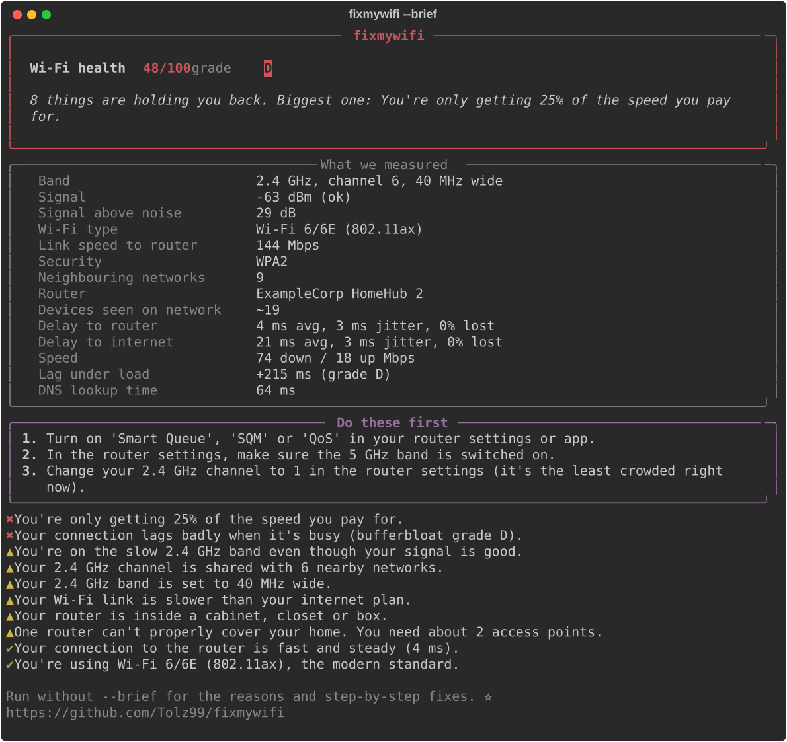

<div align="center">

# fixmywifi

**Why is my Wi-Fi slow? Run one command and find out, in plain English.**

fixmywifi checks your Wi-Fi connection, your router, your neighbours' networks and your internet line,
asks you a few questions about your home, then tells you exactly what's wrong and how to fix it.


[](LICENSE)
[](CONTRIBUTING.md)



</div>

## Try it in 30 seconds

You need Python 3.9 or newer (already on most Macs and Linux machines). Then:

```bash
pipx run --spec git+https://github.com/Tolz99/fixmywifi fixmywifi
```

or, with [uv](https://docs.astral.sh/uv/):

```bash
uvx --from git+https://github.com/Tolz99/fixmywifi fixmywifi
```

or install it for good:

```bash
pip install git+https://github.com/Tolz99/fixmywifi
fixmywifi
```

Just want to see what a report looks like? `fixmywifi --demo` uses a made-up home.

## What it does

1. **Asks about your home** (1 minute, every question is optional): size, rooms, floors, wall type, where the router sits, mesh or extenders, how many devices, your plan speed, what's bugging you.
2. **Measures everything it can** without admin rights and without changing a single setting.
3. **Tells you what's wrong**, why, and what to do about it, starting with the free fixes.

### What it checks

| Check | What it catches |
|---|---|
| Signal strength and noise | Weak signal, interference from microwaves, baby monitors and neighbours |
| Band (2.4 / 5 / 6 GHz) | Stuck on slow 2.4 GHz when you could be on 5 GHz |
| Channel crowding | Neighbours on your channel, plus the **quietest channel to switch to** |
| Channel width | 40 MHz on 2.4 GHz (bad), 20 MHz on 5 GHz (leaving speed on the table), 160 MHz in a crowded block |
| Radar (DFS) channels | Random disconnects caused by radar-shared 5 GHz channels |
| Wi-Fi generation | Old Wi-Fi 4 gear holding back a fast plan |
| Link speed vs plan | Whether Wi-Fi or your provider is the bottleneck |
| Delay and packet loss | Problems *inside* your home vs on your provider's side |
| Speed test | Download and upload, compared with what you pay for |
| **Bufferbloat** (lag under load) | Why calls freeze when someone starts a download, and how to fix it |
| DNS speed | Slow "phone book" lookups vs Cloudflare, Google and Quad9 |
| Security | Open, WEP, WPA, TKIP mixed mode (also a hidden speed killer) |
| Your home | Whether one router can cover your size, walls and floors; cabinets, corners, extenders, router age, device count |
| Router model | Identified automatically via UPnP when your router supports it |

### Room-by-room walk test

```bash
fixmywifi --rooms
```

Carry your laptop from room to room, type each room's name, and fixmywifi maps your dead zones and tells you
**where to put a mesh unit** (hint: halfway, not in the dead zone).

### Share your results

Reports never include your network name, router address or device addresses, so screenshots are safe to post.

```bash
fixmywifi --save                 # HTML + JSON report in the current folder
fixmywifi --markdown report.md   # paste into a GitHub issue or Reddit post
fixmywifi --brief                # the short version, for a screenshot
fixmywifi --json                 # raw data, for scripts
```

[See a full example report.](docs/example-report.md)

## All options

```text
fixmywifi [--rooms] [-q] [--answers FILE] [--no-speedtest] [--brief]
          [--save] [--html FILE] [--markdown FILE] [--json] [--show-names] [--demo]

  --rooms          walk test: measure Wi-Fi room by room and find dead zones
  -q, --quick      skip the questions about your home
  --answers FILE   read your answers from a JSON file (see docs/answers.example.json)
  --no-speedtest   skip the speed + bufferbloat test (~20 s)
  --brief          short report: score, to-do list, one line per problem
  --save           save HTML and JSON reports in the current folder
  --html FILE      write a shareable HTML report
  --markdown FILE  write a Markdown report
  --json           print raw results as JSON
  --show-names     include network names and addresses in exported files
  --demo           example report from a made-up home
```

## Privacy and safety

- **Read-only.** fixmywifi never changes a setting on your computer or router, and never logs in to anything.
- **No account, no tracking, no analytics.**
- The only outside services it talks to are Cloudflare's public speed test (`speed.cloudflare.com`) and the
  public DNS resolvers it compares yours with (1.1.1.1, 8.8.8.8, 9.9.9.9). Nothing about you is sent.
  Skip the speed test with `--no-speedtest`.
- Network names and hardware addresses are removed from every report unless you pass `--show-names`.

## Platform notes

| | How it reads Wi-Fi | Notes |
|---|---|---|
| macOS | `system_profiler` | No admin needed. Since macOS 14.4 network names are hidden unless your terminal has Location access, but fixmywifi doesn't need them. |
| Linux | `iw` + `nmcli` | Install `iw` and NetworkManager for full detail. No root needed. |
| Windows | `netsh wlan` | On Windows 11, turn on Location services (Settings → Privacy & security → Location) or Windows hides Wi-Fi details. English output for now; other languages welcome. |

If you're on a cable, fixmywifi notices and checks your internet line instead.

## How the advice works

Every piece of advice is a small, readable **rule** in [`src/fixmywifi/rules/`](src/fixmywifi/rules). Each rule
looks at the measurements and your answers, and returns a finding with a severity, a plain-English
explanation and fix steps. The score starts at 100 and drops for each problem, with the free settings
changes listed before anything that costs money.

The thresholds come from widely used industry guidance: -67 dBm as the minimum for voice and video,
25 dB+ signal-to-noise as healthy, 1/6/11 as the only non-overlapping 2.4 GHz channels, and the bufferbloat
grades popularised by the Waveform and DSLReports tests. Disagree with one? Open an issue. That's the point
of doing this in the open.

## Contributing

This is a community project, and the easiest contribution is a **new rule**: about 20 lines of Python with a
test. Other great first contributions:

- **Your router's settings names.** "On a TP-Link Archer, it's under Advanced → Wireless → ..." makes the fixes far more useful.
- **Non-English Windows support.** Share `netsh wlan show interfaces` output in your language.
- **More platforms.** FreeBSD, ChromeOS (Crostini), Android (Termux).
- **Translations** of the report text.

See [CONTRIBUTING.md](CONTRIBUTING.md). Good first issues are labelled
[`good first issue`](https://github.com/Tolz99/fixmywifi/labels/good%20first%20issue).

## Roadmap

- [ ] Optional read-only router integrations (OpenWrt, UniFi, eero, ASUS) to check settings directly
- [ ] Compare two saved reports ("did my fix work?")
- [ ] 6 GHz / Wi-Fi 7 channel planning
- [ ] Translated reports
- [ ] Publish to PyPI and Homebrew

## License

[MIT](LICENSE). Use it, fork it, ship it.

If fixmywifi helped, a ⭐ helps other people with slow Wi-Fi find it.
